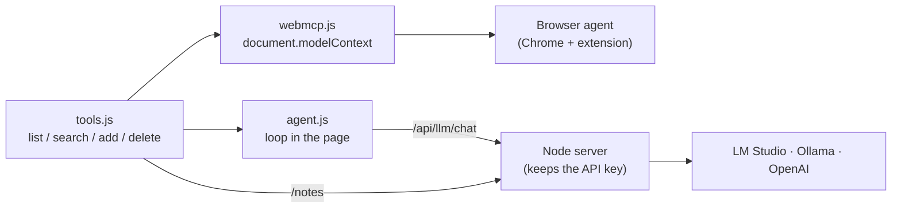

# Step 07: WebMCP + your own agent

The Notes app as a web page that offers its tools in two ways:

1. **WebMCP**: the page registers its tools with `document.modelContext`, so the
   browser's own agent can use them (Chrome origin trial, Block 8).
2. **Its own agent**: the same tool definitions go into an agent loop (Block 5)
   in the page, with any LLM that speaks the OpenAI Chat Completions API:
   **LM Studio**, **Ollama** or **OpenAI** (or any other OpenAI-compatible endpoint).



No MCP server here: WebMCP is a browser API, and the agent calls the page's
tools directly. The notes are the same as in step 01 (`step-01-notes-app/data/notes.db`).

## Run

```bash
npm install
cp .env.example .env    # optional: provider, models, OpenAI key
npm run dev
```

Open http://localhost:3007, pick a provider and a model, and ask:

- "What did I note about MCP?"
- "Add a note: buy milk, tag it personal" (the page asks you before any write)
- "Delete my oldest note" (asks first, too)

## Providers

All three use the same code path (`src/llm.ts`): `GET /models` for the model
list, `POST /chat/completions` with `tools` for each step. Use a model that
supports **tool calling**; small models may answer without using the tools.

| Provider | Setup | Default URL |
|----------|-------|-------------|
| **LM Studio** | Download a model with tool-use support, then Developer tab → *Start Server* (or `lms server start`) | `http://localhost:1234/v1` |
| **Ollama** | Install from ollama.com, `ollama pull <model>` with a model tagged *tools* on ollama.com/search | `http://localhost:11434/v1` |
| **OpenAI-compatible** | Set `OPENAI_API_KEY` and `OPENAI_MODEL` in `.env`; for another endpoint (vLLM, OpenRouter, a company gateway) also `OPENAI_BASE_URL` | `https://api.openai.com/v1` |

`LLM_PROVIDER` in `.env` picks the provider the page starts with. The page
never sees the key: it sends the provider name, the model and the messages to
`/api/llm/chat`, and the server adds the key.

## WebMCP in Chrome (optional)

Chrome 155+ with `chrome://flags/#enable-webmcp-testing`, plus a consuming
agent such as the Example WebMCP extension
(github.com/GoogleChromeLabs/webmcp-extension). The page then shows
"WebMCP: 4 tools registered". Without it, the in-page agent works anyway.
The API is an origin trial and "subject to change".

## Test without a browser

With `npm run dev` running in another terminal:

```bash
npm run test:agent                       # default provider
npm run test:agent -- ollama             # another provider
npm run test:agent -- openai <model>     # provider + model
```

It runs the page's tools and agent loop in Node against the real LLM, asks
for notes about "MCP" and to delete one, denies the delete, and fails if the
model called no tool.

## Files

| File | What it does |
|------|--------------|
| `public/tools.js` | The 4 tools in WebMCP shape: `name`, `description`, `inputSchema`, `execute`, `annotations` |
| `public/webmcp.js` | Registers them with `document.modelContext` when the browser has it |
| `public/agent.js` | The agent loop: WebMCP tools → OpenAI `tools`, run tool calls, bounded to 8 steps |
| `public/app.js` | UI: provider/model picker, chat, approval dialog, notes list |
| `src/index.ts` | Node server: static files, notes REST API, LLM proxy |
| `src/llm.ts` | The three providers and the two calls (`/models`, `/chat/completions`) |
| `scripts/test-agent.mjs` | End-to-end test without a browser |

## Security (Block 6 applied)

- **Write tools ask first**: every tool without `readOnlyHint` (add, delete)
  needs your OK in a dialog before it runs.
- **Note text is untrusted**: the read tools carry `untrustedContentHint`, and
  the system prompt tells the model to treat tool results as data.
- **Key stays on the server**, never in the browser.
- **Local only**: the server listens on `127.0.0.1` and rejects requests from
  other web pages (`Origin` check), so no other site can use your key or
  delete your notes.

## Try next

- Add a `notes_by_tag` tool to `tools.js` (the REST API has `/notes/tags/:tag`
  in step 01). Both the WebMCP agent and the in-page agent get it.
- Ask the same question with two models and compare which tools they call.
- Put the poisoned note from Block 6 into the database and watch the approval
  dialog stop the write.
