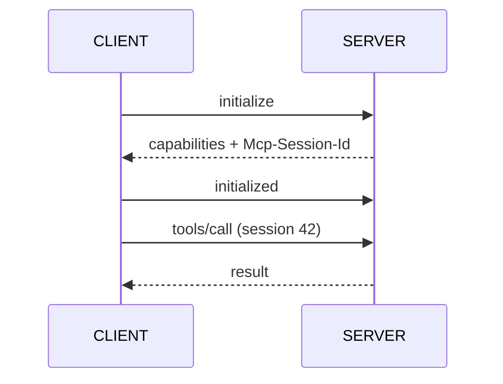
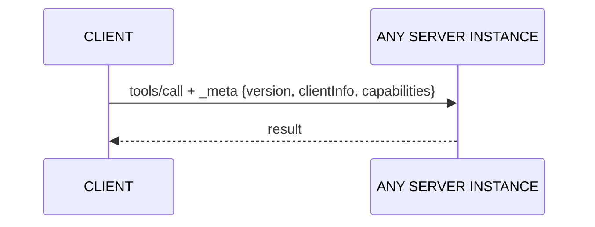
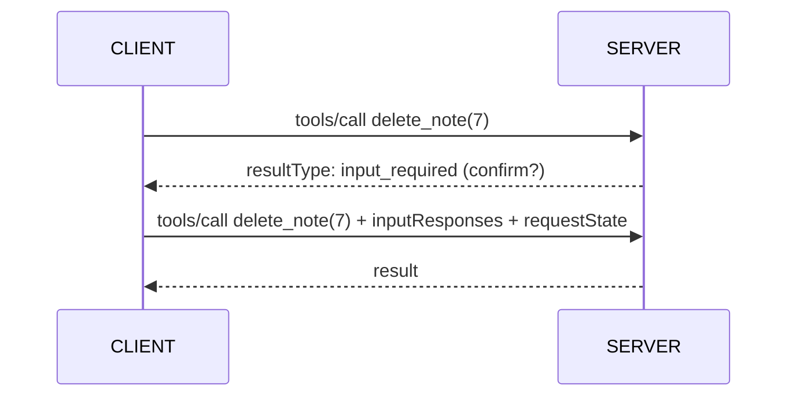

# Block 7: MCP v2 - The Stateless Protocol

### Spec 2026-07-28 and SDK v2: what changed, why, and how to migrate

---

## First: what "MCP v2" means

There is no spec called "v2". MCP versions are **dates**:

| Spec | Note |
|------|------|
| 2024-11-05 | first public release |
| 2025-03-26 | Streamable HTTP, OAuth, tool annotations |
| 2025-06-18 | structured tool output, elicitation |
| 2025-11-25 | Tasks (experimental), extensions (informal) |
| **2026-07-28** | **stateless core** - the big break |

"**v2**" is the **SDK** generation that implements 2026-07-28:
TypeScript `@modelcontextprotocol/server` / `client` **2.x** (since 2026-07-27),
C# SDK **2.0**. Everything we built today used SDK **v1** (`@modelcontextprotocol/sdk`).

---

## Why a breaking release?

Today's MCP is a **bidirectional, stateful** protocol. Remember Block 1:



Fine for a local `stdio` subprocess.

---

## Painful for a remote server

- **Sticky sessions**: request 2 must hit the instance that saw request 1
- **Shared session store** when you scale out
- **Held-open streams** so the server can ask the client things mid-call
- **Gateways must parse JSON bodies** to know what a request does

---

## The maintainers' answer

> "A remote MCP server that previously needed sticky sessions, a shared
> session store, and deep packet inspection at the gateway can now run
> behind a plain round-robin load balancer."
>
> *- MCP blog, 2026-07-28 release candidate*

MCP goes from **stateful + bidirectional** to **stateless request/response**.

Result: MCP servers run like any HTTP API - serverless, edge, autoscaled.

---

## v1 vs. v2 on the wire



- **No `initialize` / `initialized` handshake** (removed)
- **No `Mcp-Session-Id`** (removed)
- Every request **describes itself** in `_meta`
- Optional **`server/discover`** to fetch capabilities up front

---

## One request, no handshake

```bash
curl -X POST http://localhost:3005/mcp \
  -H 'content-type: application/json' \
  -H 'accept: application/json, text/event-stream' \
  -H 'MCP-Protocol-Version: 2026-07-28' \
  -H 'Mcp-Method: tools/call' -H 'Mcp-Name: list_notes' \
  -d '{"jsonrpc":"2.0","id":1,"method":"tools/call",
       "params":{"name":"list_notes","arguments":{"limit":1},
       "_meta":{"io.modelcontextprotocol/protocolVersion":"2026-07-28",
                "io.modelcontextprotocol/clientInfo":{"name":"curl","version":"1"},
                "io.modelcontextprotocol/clientCapabilities":{}}}}'
```

```json
{"result":{"content":[{"type":"text","text":"Showing 1 note(s): ..."}],
 "resultType":"complete",
 "_meta":{"io.modelcontextprotocol/serverInfo":{"name":"personal-knowledge-assistant"}}}}
```

---

## Header-based routing

New required headers on Streamable HTTP: **`Mcp-Method`** and **`Mcp-Name`**.

> "so load balancers, gateways, and rate-limiters can route on the
> operation without inspecting the body."

Servers reject requests where header and body **disagree**:

```json
{"error":{"code":-32020,
  "message":"Bad Request: the request headers and body disagree:
   the body carries params.name=\"list_notes\" but the
   Mcp-Name header names \"delete_note\""}}
```

**Security link to Block 6:** a gateway can now allow/deny `delete_note`
on a header - GuardLayer moves out of the client into infrastructure.

---

## But my agent needs state!

State moves from the **transport** into the **application**.

> Have a tool return an explicit handle (e.g. a `basket_id`) and have
> the model pass it back as an argument.

```text
create_basket()                     → { basket_id: "b-7f3" }
add_item(basket_id: "b-7f3", ...)   → ok
checkout(basket_id: "b-7f3")        → order #1234
```

The maintainers: this "works better than session state hidden in the transport".
The model **sees** the state, so it can reason about it - and so can your logs.

---

## Server asks the client: MRTR

v1: server sends `elicitation/create` or `sampling/createMessage` **into a
held-open stream**. Stateless servers can't hold streams.

v2: **Multi Round-Trip Requests** (SEP-2322).

Any instance can pick up the retry: everything it needs is in the payload.
Server-to-client requests are only allowed **during** a client request: the
user is "never prompted out of nowhere".

---

## MRTR: a confirm step



---

## Everything else in 2026-07-28

| Area | Change |
|------|--------|
| **Caching** | `ttlMs` + `cacheScope` on list/read results, deterministic order (stable prompt caches) |
| **Tracing** | W3C `traceparent` / `tracestate` / `baggage` in `_meta` |
| **Schemas** | full JSON Schema 2020-12 for tools (`oneOf`, `$ref`, ...) |
| **Errors** | missing resource: `-32002` → `-32602` |
| **Extensions** | formal framework: **Tasks**, **MCP Apps**, Enterprise Managed Auth |
| **Auth** | validate `iss` (RFC 9207), issuer-bound credentials, DCR deprecated → CIMD |
| **Deprecated** | Roots, Sampling, Logging, legacy HTTP+SSE transport |

Deprecated = still works for **at least 12 months** (new lifecycle policy).

---

## Deprecated: what to use instead

| Deprecated | Use instead |
|------------|-------------|
| **Roots** | tool parameters, resource URIs, server config |
| **Sampling** | call the LLM provider API directly |
| **Logging** | `stderr` (stdio) or OpenTelemetry |
| **HTTP+SSE** | Streamable HTTP |

Our workshop code already logs to `stderr` and never used HTTP+SSE.

---

## SDK v2 (TypeScript): what changes in code

| v1 `@modelcontextprotocol/sdk` | v2 |
|---|---|
| one package | `.../server`, `.../client`, `.../node` |
| `ListToolsRequestSchema` | `'tools/list'` (method string) |
| `server.tool(...)` | `registerTool(...)` only |
| Zod v3 | Zod **>= 4.2** |
| `server.connect(transport)` | `serveStdio(() => createServer())` |
| SSE, WebSocket transports | **removed** |
| `McpError` | `ProtocolError` |

v1 gets fixes for **at least 6 months** after 2026-07-27.

---

## Hands-on: migrate the Notes server

```bash
cp -r Code/step-02-notes-mcp/complete my-notes-v2 && cd my-notes-v2
git init -q && git add -A && git commit -qm v1   # so you can diff
npx @modelcontextprotocol/codemod@latest v1-to-v2 .
npm install zod@4.6.7 && npm install
npx tsc --noEmit
```

What we saw when we ran it on our server:

- Codemod: **22 changes in 9 files**, no `@mcp-codemod-error` markers
- It warned: `zod 3.25.76` cannot satisfy v2's floor (`>=4.2.0`)
- **`tsc` still failed** - next slide

> Lesson: the codemod does the imports and method names. The types are yours.

---

## The part the codemod doesn't do

v2 handler types are strict: `type: "text"`, `role: "user"`, `inputSchema.type: "object"`.
Our handlers returned `{ type: string }` - TypeScript widened the literals.

```typescript
import type { CallToolResult, Tool, PromptMessage } from '@modelcontextprotocol/server';

export const noteToolDefinitions: Tool[] = [ /* unchanged */ ];

export function handleAddNote(db, args): CallToolResult { /* unchanged */ }

export async function getBrainstormPrompt(db, args): Promise<PromptMessage> { /* unchanged */ }
```

Annotate with the SDK's types; the bodies stay the same.

---

## Serve both eras: the factory

```typescript
import { serveStdio } from '@modelcontextprotocol/server/stdio';
import { Server } from '@modelcontextprotocol/server';

const db = initDatabase();

function createServer(): Server {
  const server = new Server(
    { name: 'personal-knowledge-assistant', version: '2.0.0' },
    { capabilities: { tools: {}, resources: {}, prompts: {} } }
  );
  registerTools(server, db);
  registerResources(server, db);
  registerPrompts(server, db);
  return server;
}

await serveStdio(() => createServer());
```

Without this, a v2 server on `server.connect(...)` **still speaks only 2025**.

---

## Test it: one server, two eras

```typescript
const client = new Client(
  { name: 'test', version: '1.0.0' },
  { versionNegotiation: { mode: 'auto' } }   // or { pin: '2026-07-28' }
);
await client.connect(new StdioClientTransport({ command: 'npx', args: ['tsx', 'src/index.ts'] }));
console.log(client.getProtocolEra());
```

Our run (`npm run test:client` in `Code/step-06-notes-mcp-v2`):

```text
"auto"               era= modern  tools= add_note,search_notes,list_notes,delete_note,get_quote
{"pin":"2026-07-28"} era= modern  tools= add_note,...
default              era= legacy  tools= 5
```

A default `Client` still does the 2025 handshake. New behaviour is **opt-in**.

---

## Go remote: stateless HTTP in a few lines

```typescript
import { createServer as createHttpServer } from 'node:http';
import { createMcpHandler } from '@modelcontextprotocol/server';
import { toNodeHandler } from '@modelcontextprotocol/node';

process.env.MCP_HTTP = '1';                               // index.ts: skip stdio
const { createServer } = await import('./index.js');

const handler = createMcpHandler(() => createServer());   // fresh server per request
createHttpServer(toNodeHandler(handler)).listen(3005, '127.0.0.1');
```

`src/http.ts` also serves only `/mcp` and rejects foreign `Origin` headers.

```bash
npm run http        # then: npm run test:http, or the curl from earlier
```

No session, no sticky routing: per the spec, any number of these can sit
behind a plain round-robin balancer (Extension Challenge 11 lets you try it).

---

## Who speaks 2026-07-28 today?

Status 2026-11-12, full list in **[mcp-v2-clients.md](../mcp-v2-clients.md)**:

- **By default:** Claude Code, GitHub Copilot CLI, Windsurf; OpenAI Agents SDK,
  Vercel AI SDK, LangChain JS, Python SDK `mcp` 2.x
- **Opt-in:** Codex CLI, Google ADK, MCP Inspector (`--protocol-era modern`),
  TypeScript SDK client (`versionNegotiation`)
- **Still 2025:** VS Code Copilot, Gemini CLI; no evidence yet for
  ChatGPT, Claude Desktop
- **Your servers:** `serveStdio` / `createMcpHandler` answer **both** eras,
  so every host still works

---

## Demo: the Inspector tells you the era

```bash
npx @modelcontextprotocol/inspector@2.14.0 --cli --protocol-era modern \
  npx tsx src/index.ts --method tools/list
```

**v1 server** (`step-02-notes-mcp/complete`):

```text
Version negotiation failed: the server did not offer pinned protocol
version 2026-07-28 via server/discover (no fallback in pin mode)
```

**v2 server** (`step-06-notes-mcp-v2`): lists all 5 tools.

`--protocol-era auto` against the v1 server: falls back to 2025, also 5 tools.

**Order of migration:** servers first (serve both), clients second (`auto`),
pin `2026-07-28` last.

---

## Migration checklist

1. Run the codemod, bump Zod to >= 4.2, fix types
2. Switch entry to a **factory** (`serveStdio` / `createMcpHandler`)
3. Move any session state into **explicit handles** in tool arguments
4. Replace `elicitInput` push calls with **`inputRequired(...)`** (MRTR)
5. Replace Sampling / Roots / Logging (deprecated)
6. Remote: send `Mcp-Method` / `Mcp-Name`, set `ttlMs` on lists
7. Auth: validate `iss`, prefer CIMD over Dynamic Client Registration
8. Clients matching on error `-32002`: now `-32602`

---

## Takeaways

1. **"MCP v2" = spec 2026-07-28 + SDK 2.x.** The spec is dated, the SDK is numbered.
2. **Why:** remote MCP servers need to scale like plain HTTP APIs.
3. **What:** no handshake, no sessions, self-describing requests, MRTR,
   header routing, extensions, stricter auth.
4. **For local stdio servers** the change is small; **for remote servers** it is big.
5. **Migrate servers first** - one factory serves both eras.

Sources: `blog.modelcontextprotocol.io/posts/2026-07-28/`,
`.../2026-07-28-release-candidate/`, `ts.sdk.modelcontextprotocol.io/v2/`

---

*Next: [Block 8 - Level Up: MCP in Production](08-production.md)*
