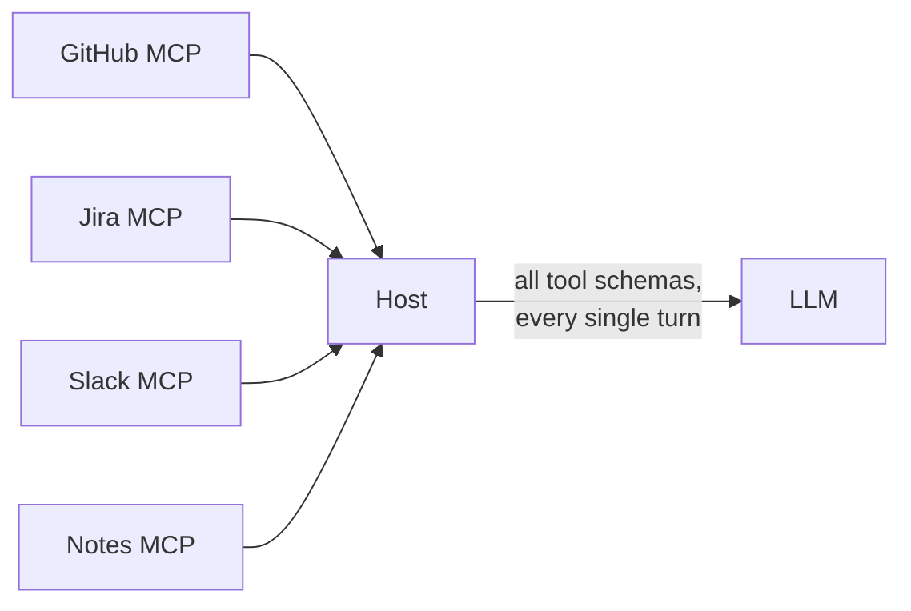
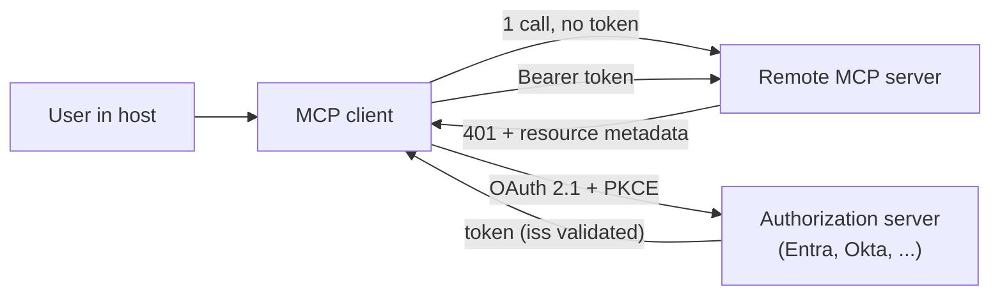
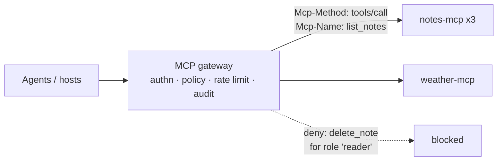

# Block 8: Level Up - MCP in Production

### From "it works on my laptop" to "the team uses it every day"

---

## Where we are

You can build a server, connect it, put it in an agent loop, defend it,
and migrate it to the stateless protocol.

This block is about the questions you get **the Monday after**:

- Why does the agent pick the wrong tool?
- Why is every request so expensive?
- How do 200 colleagues log in?
- What should we build first?

---

## 1. Design tools for agents, not for APIs

Our Notes server mirrors a REST API: `add`, `search`, `list`, `delete`.
That's a fine **start** and a weak **end state**.

| API-shaped (what we built) | Task-shaped |
|---|---|
| `list_notes` + `search_notes` + model filters | `find_notes(query, tag?, since?)` |
| `get_forecast(lat, lon)` + `search_location` | `weather_for(place)` - one call |
| returns raw rows | returns what the model needs next |

- **Fewer, bigger tools**: every tool is a decision the model can get wrong
- **Name by intent**, not by endpoint
- **Error messages that teach**: `"No note 42. Use find_notes to get IDs."`

---

## Tool metadata that pays off

```typescript
// SDK v2, McpServer (high-level API); import * as z from 'zod/v4'
server.registerTool('delete_note', {
  description: 'Delete one note by ID. Irreversible. Get IDs from find_notes.',
  inputSchema: z.object({ id: z.number().int().positive() }),
  outputSchema: z.object({ deleted: z.number() }),          // structured output
  annotations: { destructiveHint: true, idempotentHint: true }
}, async ({ id }) => {
  deleteNote(db, id);
  return { content: [{ type: 'text', text: `Deleted ${id}` }],
           structuredContent: { deleted: id } };
});
```

- **`outputSchema` + `structuredContent`**: machine-readable results (since 2025-06-18)
- **`annotations`**: hints for the host (`readOnlyHint`, `destructiveHint`, ...)
  - a host can auto-approve read-only tools and gate destructive ones
  - hints, **not** security: never trust annotations from a server you don't trust

---

## 2. The hidden cost: tool definitions

Block 4: the host sends **every tool definition in every request**.



Connect a handful of big servers and the tool list can take a large share
of the context window - before the user typed anything.

**Measure it**: count tokens of your `tools` array for your real setup.

---

## Patterns against tool bloat

- **Curate**: expose 5 good tools, not 40 thin ones; split servers by job
- **Load on demand**: tool search - the model first searches for tools,
  then only the matching definitions are loaded
  (e.g. Claude API tool search tool)
- **Code execution with MCP**: the agent writes code that calls MCP tools
  as functions; intermediate data stays in the sandbox instead of the context
  (Anthropic engineering blog, Nov 2025)
- **Cache**: v2's `ttlMs` + deterministic list order keep the tool list
  stable, so the provider's **prompt cache** hits

---

## 3. Remote MCP: auth for real users



- The MCP server is an **OAuth resource server**; your IdP issues tokens
- Clients identify via **Client ID Metadata Documents** (CIMD); Dynamic Client
  Registration is deprecated in 2026-07-28
- **Enterprise Managed Authorization** extension: IT controls which servers
  employees may connect to
- **Never** pass the user's token through to downstream APIs unchanged

---

## The MCP gateway pattern



v2 makes this cheap: **route and authorize on headers**, scale servers
round-robin, propagate `traceparent` for one trace across agent → gateway → server.

Block 6's GuardLayer, but **central**: one policy for every agent in the company.

---

## 4. Long-running work: Tasks extension

Some tools take minutes: reports, builds, data exports.

- Tool returns a **task handle** instead of blocking
- Client polls `tasks/get`, can `tasks/update` / `tasks/cancel`
- Notifications via one opt-in `subscriptions/listen` stream
- Lives in the **`io.modelcontextprotocol/tasks`** extension (moved out of core
  in 2026-07-28 because production use showed it needed a redesign)

**Rule of thumb:** > ~30 s or might fail halfway → task, not a blocking call.

---

## 5. MCP Apps: tools that return UI

Official extension (SEP-1865): a tool declares a **UI template** up front;
the host renders it in the conversation (forms, charts, previews).

- Host can **prefetch, cache and security-review** the UI before it runs
- UI actions go through the **normal** JSON-RPC path → same consent + audit
- The UI is **untrusted content**: sandboxed iframe, the lethal trifecta
  still applies

Good fit: confirmations, pickers, dashboards. Bad fit: things text does well.

---

## Outlook: WebMCP - tools from a web page

MCP Apps: a server sends UI to the host. **WebMCP** flips it: a web page
offers tools to the agent in the browser.

- A **browser API**, not MCP on the wire: no JSON-RPC, no transport
- Tools run **in the page**, with the user's login and session
- Same building blocks you know: `name`, `description`, `inputSchema`, annotations
- Status: Chrome **origin trial** since Chrome 149, "subject to change";
  the API already moved from `navigator` to `document`. Edge runs its own trial

Lethal trifecta again: a page tool reads private data, and page content is
**untrusted**.

---

## Demo: WebMCP on the Notes app

```javascript
// Code/step-07-webmcp-agent/public/tools.js + webmcp.js
await document.modelContext.registerTool({
  name: 'search_notes',
  description: 'Search the user\'s notes by keyword.',
  inputSchema: { type: 'object', properties: { query: { type: 'string' } } },
  execute: async ({ query }) =>
    JSON.stringify(await (await fetch(`/notes/search?q=${encodeURIComponent(query)}`)).json()),
  annotations: { readOnlyHint: true, untrustedContentHint: true },
});
```

Step 07 → `localhost:3007`: Chrome's agent via WebMCP, or the page's own
agent loop with **LM Studio, Ollama or OpenAI**. Same tools, no MCP server.

---

## 6. Test tools like you test prompts

Your tool **description is a prompt**. Treat it like one:

1. Write 20 realistic user requests per server ("what did I note about the Q3 offsite?")
2. Record which tool + arguments **should** be called
3. Run them through your agent loop (Block 5) and score: right tool? right args?
4. Change one description → re-run → compare

Use the Inspector for **does it work**, evals for **does the model use it right**.

---

## 7. MCP, Skills, function calling, A2A: which when?

| Need | Reach for |
|---|---|
| One app, a few functions, one model provider | plain **function calling** |
| Reusable access to a system across hosts and agents | **MCP server** |
| Know-how: procedures, templates, scripts loaded on demand | **Skills** |
| Agents from different vendors delegating to each other | **A2A** |

They combine: a Skill tells the agent **how** to do the task, MCP gives it
**access** to the systems. MCP is governed by the **Agentic AI Foundation**
(Linux Foundation) - vendor-neutral, like A2A.

---

## 8. What to build: use cases

Full list with risk notes: **[use-cases.md](../use-cases.md)**

| Use case | Shape | Trifecta legs |
|---|---|---|
| Internal knowledge search | read-only resources + 1 search tool | private data |
| Ticket triage (Jira, GitHub) | read + label/comment tools | private + untrusted |
| Ops copilot (logs, metrics) | read-only, remote, gateway | private + untrusted |
| Sales / CRM assistant | read + draft, human sends | all three → HITL |

**Start read-only. Add write tools one at a time, behind approval.**

---

## Capstone exercise (45 min, groups of 3)

Pick a use case from `use-cases.md` - or one from **your own job**.

1. **Tool surface**: max 5 task-shaped tools (name, description, args)
2. **Trifecta check**: which legs? Which one do you cut?
3. **Deployment**: local stdio or remote HTTP? Who authenticates how?
4. **State**: anything that needs a handle (`*_id`) between calls?
5. **Eval**: write 5 test requests with the expected tool call

**Build**: scaffold the server with SDK v2 (`Code/step-06-notes-mcp-v2` as template),
stub the tools, call them from the Inspector or `test-client.ts`.

**Present**: 3 minutes per group - surface, risk, one thing that surprised you.

---

## Production checklist

- [ ] Task-shaped tools, descriptions tested with evals
- [ ] `annotations` set, destructive tools behind human approval
- [ ] Token cost of the tool list measured
- [ ] Remote: OAuth via your IdP, `iss` validated, no token passthrough
- [ ] Gateway: per-tool policy, rate limits, audit log, tracing
- [ ] Lethal trifecta: at least one leg cut per agent
- [ ] Dependencies pinned, SDK on v2 or v1 with an upgrade date
- [ ] Owner + on-call for each server (it's a production API now)

---

## Takeaways of the day

1. **MCP = one protocol between agents and systems.** Tools, resources, prompts.
2. **An agent = model + tools + loop.** Bound the loop.
3. **Security = control actions, not content.** Break the lethal trifecta.
4. **MCP v2 (2026-07-28) = stateless.** Remote servers scale like HTTP APIs.
5. **Production = tool design + context cost + auth + gateway + evals.**

---

## Resources

- Spec 2026-07-28: `modelcontextprotocol.io/specification/2026-07-28`
- Release notes: `blog.modelcontextprotocol.io/posts/2026-07-28/`
- TypeScript SDK v2 docs + migration: `ts.sdk.modelcontextprotocol.io/v2/`
- Reference servers: `github.com/modelcontextprotocol/servers`
- Simon Willison, lethal trifecta: `simonwillison.net/series/prompt-injection`
- Use cases: `use-cases.md` in this repo

---

## Q&A

### Any Questions?

---

## Thank You!

### Lars Gregori

**Blog**: larsgregori.de
**LinkedIn**: /in/larsgregori

Let me know what you build with MCP - safely!

---

## Feedback - please be specific

For **each block** (1 Intro · 2 Notes · 3 Weather · 4 Integration · 5 Agents ·
6 Security · 7 MCP v2 · 8 Production):

- **Useful for my job?** 1-5
- **Level:** too basic · right · too advanced
- **One thing** you will use next week

> We changed this workshop based on your feedback. Concrete answers help most.

---

*End of Workshop*

*Thank you for attending VibeKode Berlin 2026!*

*Next (optional): [Appendix - Build Your Own MCP Client](appendix-mcp-client.md)*
